# STERN

**Pretraining a video encoder on shared lab workstations with DiLoCo: one training failure, its cause, and what correcting it bought.**

STERN pretrains video encoders on unlabelled face clips and measures them on valence and arousal prediction. Training runs on lab workstations shared with teaching, with DiLoCo, a method in which machines train alone and merge rarely. For 230 rounds the loss fell while the encoder was losing information it had at initialisation. This README shows how that was found, what caused it, and what the corrected setting gives.

Solo project, summer 2026 internship. The same story as a page, with a figure that plays as you scroll: [`index.html`](index.html) (open the file, no build step). Notebook that draws every figure from the tables in `docs/data/`: [`notebooks/stern_overview.ipynb`](notebooks/stern_overview.ipynb).

## What worked

- **The cause was found and removed.** DiLoCo's default outer step multiplies each update by up to 7. At 7x the residual-stream norm reaches 370 to 460 and a motion readout falls below its random-initialisation level. At 1x the norm stays near 90 and the readout stays near its random-initialisation level. That readout splits by token; a stricter one, split by clip, puts every DiLoCo setting below random initialisation (appendix B).
- **Encoders trained with the corrected setting carry signal downstream.** On a frozen probe for valence and arousal, the from-scratch ViT-B reads 0.189 against 0.066 for a random initialisation; two public pretrained models read 0.200 and 0.209 on the same probe. A smaller from-scratch encoder, fine-tuned, beats a random initialisation by +0.031 (95% interval +0.005 to +0.057) at round 48; by round 78 the difference is no longer resolved.
- **Continued pretraining improves a released model.** Fine-tuned CCC goes from 0.287 to 0.331 over 30 seeds; 29 of the 30 improve.
- **The training system.** Decentralized training on a pool of 113 single-GPU workstations, with a watcher that keeps runs alive and keeps them off the machines during class hours.

## What is still open

- In the from-scratch ViT-B, blocks 4 to 12 still contribute almost nothing to the reconstruction. Ten changes to the recipe did not alter that. A 3-block encoder reaches the same loss, which points at the objective.
- Fine-tuned, the from-scratch encoder is far from the released model: +0.03 over a random initialisation against about +0.26.

In the figures: blue is an effective update of 0.7x or 1x, green 2x to 3x, orange the 7x default; a solid line is the DiLoCo outer step, a dashed line plain AdamW; grey is a random initialisation.

## 1. DiLoCo in one figure

The pool is 113 lab workstations with one GPU each, joined by 1 GbE. Exchanging gradients at every step over that network is slower than training on one machine (appendix D). DiLoCo (Douillard et al., 2023) avoids the exchange: in each round every machine starts from the same weights and trains alone on its own data; the machines then send their weight changes, the changes are averaged, and an *outer* optimiser applies the average to the shared weights.

The outer optimiser is SGD with Nesterov momentum. With `g` the averaged update, `b` a buffer and `w` the shared weights:

```
b <- momentum * b + g
w <- w - outer_lr * (g + momentum * b)
```

If `g` keeps the same direction, the step grows round after round towards `outer_lr / (1 - momentum)` times `g`. With the paper's defaults, 0.7 and 0.9, that is 7.

<p align="center">
  <picture>
    <source media="(prefers-color-scheme: dark)" srcset="assets/diloco_round_dark.svg">
    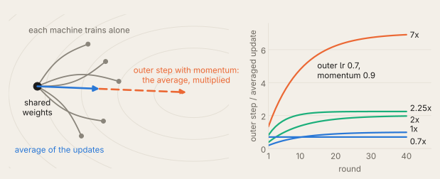
  </picture>
</p>

The left panel is a schematic, not data. The right panel is the formula above for a constant update direction, so for a real run it is an upper bound.

## 2. The symptom: the loss falls, one block does the work

Masked reconstruction in the style of VideoMAE (16 frames at 224 px, tubelet 2, patch 16, mask ratio 0.9), with a ViT-B encoder (width 768, depth 12, 12 heads) and a depth-4 decoder, written from scratch with no pretrained weights, on an unlabelled 218-hour subset of VoxCeleb2.

Every early run was ranked on reconstruction validation loss. This is the longest one, on 16 machines with the default outer step.

<p align="center">
  <picture>
    <source media="(prefers-color-scheme: dark)" srcset="assets/loss_curve_dark.svg">
    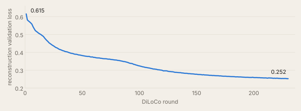
  </picture>
</p>

A block-skip test replaces one encoder block with the identity and measures how much the held-out reconstruction error rises. Below: ten encoders trained for 20 rounds on one machine (seven settings, three of them with two seeds), and a random initialisation.

<p align="center">
  <picture>
    <source media="(prefers-color-scheme: dark)" srcset="assets/block_skip_dark.svg">
    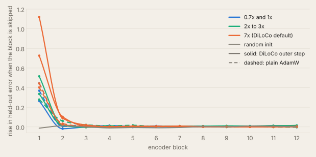
  </picture>
</p>

Skipping block 1 costs 0.26 to 1.12. Skipping any one of blocks 4 to 12 costs at most 0.017; the same test on a random initialisation varies within ±0.013. After 100 rounds on 16 machines, block 2 contributes as well (block 1 costs 0.42, block 2 0.16) and blocks 4 to 12 still do not (at most 0.014).

## 3. The cause: the size of the update

Define the effective multiplier as `outer_lr / (1 − momentum) × lr_mult`, and reach the same value by two routes: through the outer step, or with plain AdamW and a larger learning rate.

<p align="center">
  <picture>
    <source media="(prefers-color-scheme: dark)" srcset="assets/stream_norm_dark.svg">
    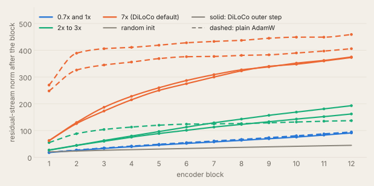
  </picture>
</p>

The second measurement is motion R²: a linear map from the frozen last-block tokens to how much each patch changes between frames. It says whether the encoder keeps information about motion.

<p align="center">
  <picture>
    <source media="(prefers-color-scheme: dark)" srcset="assets/dose_response_dark.svg">
    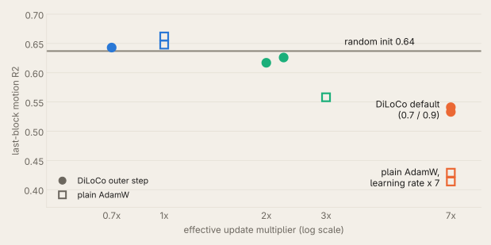
  </picture>
</p>

At 0.7x and 1x the norm ends near 90 and motion R² stays at 0.64 to 0.66, the level of a random initialisation (0.64). At 7x the norm ends between 370 and 460 and motion R² falls to 0.53 to 0.54 with DiLoCo and to 0.41 to 0.43 with plain AdamW (table in appendix E).

Plain AdamW at seven times the learning rate is affected more than DiLoCo at 7x, so the outer momentum is not what does it: the size of the update is. The validation loss cannot show it: across all these settings it stays between 0.513 and 0.548.

## 4. The correction, and what it bought

Two downstream checks were run on encoders trained at an effective multiplier of 1x. Both use AFEW-VA (600 clips, 240 actors) and the concordance correlation coefficient (CCC) on held-out actors: 1 is perfect agreement with the human annotation, 0 is none.

### Frozen features

The encoder is frozen and a small attentive probe is trained on its layer-6 tokens, 3 seeds, next to a random-initialisation control probed in the same job.

<p align="center">
  <picture>
    <source media="(prefers-color-scheme: dark)" srcset="assets/probe_ladder_dark.svg">
    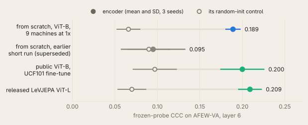
  </picture>
</p>

The from-scratch ViT-B, trained for 60 rounds on 9 machines at 1x, reads 0.189 against 0.066 for its control. A public VideoMAE V2 ViT-B fine-tuned on UCF101 action labels reads 0.200 and the released LeVJEPA ViT-L 0.209 on the same probe. Scope: three seeds, one layer, a small probe; the controls are not seeded, so differences are read within a row.

### Fine-tuned, against a random initialisation

A paired test, called the gate: fine-tune the encoder and a random initialisation with the same 10 seeds, and report the paired difference in CCC with a 95% interval. The run is on 14 machines, with DiLoCo at outer learning rate 0.1 and momentum 0.9, an effective multiplier of 1x. The model is a smaller encoder (depth 7) trained with the LeVJEPA objective.

<p align="center">
  <picture>
    <source media="(prefers-color-scheme: dark)" srcset="assets/gate_curve_dark.svg">
    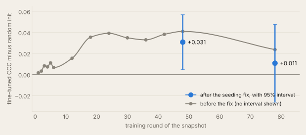
  </picture>
</p>

At round 48 the encoder reaches a CCC of 0.089 against 0.058 for a random initialisation: +0.031 [+0.005, +0.057]. At round 78 the difference is +0.011 and the interval includes zero. Earlier snapshots are shown without intervals because of a seeding bug fixed on 2026-11-01 (appendix D). For scale, the released ViT-L scores about +0.26 on this gate. It is one training run.

## 5. What is still open: the deep blocks

Lowering the update removes the norm growth and the loss of motion information. It does not make blocks 4 to 12 contribute. Ten variants of the 7x recipe were tried against that, and none changes it (appendix A).

A 3-block encoder trained with the same recipe reaches the same validation loss as the 12-block one: 0.516 and 0.518 against 0.524 and 0.525, two seeds each. The reconstruction objective at this scale can be met with a few blocks, so the next thing to change is the objective, not the optimiser.

A stricter motion readout, split by clip, shows the same thing from another side: motion information decreases with depth in every trained encoder (appendix B).

## 6. Continued pretraining of a released model

Start from the released LeVJEPA ViT-L, continue its self-supervised pretraining on the same unlabelled face video for about 1,080 encoder steps, then fine-tune on AFEW-VA. Thirty seeds per arm, one job per seed.

<p align="center">
  <picture>
    <source media="(prefers-color-scheme: dark)" srcset="assets/continued_pretraining_dark.svg">
    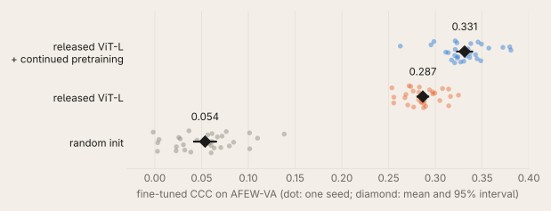
  </picture>
</p>

Paired gain +0.045, 95% interval [+0.036, +0.053]; 29 of 30 seeds improve. The gain is in valence; arousal is unchanged (appendix E). Scope: 48 held-out actors, 102 clips, one identity split. The snapshot was chosen by a small frozen probe among five runs at four learning rates.

## 7. The system

The pool is 113 single-GPU workstations in five hardware tiers, joined by 1 GbE and shared with teaching. Exchanging gradients at every step was measured first: eight machines together process 11.1 samples/s where one alone processes 24.0. So each worker is one GPU process with no `torch.distributed`: it trains on the shards it holds and pushes a checkpoint once per round. A watcher advances every run each minute, restarts a dead job once, and keeps every job off the machines on weekdays from 08:00 to 20:00. About 1.9k tests mirror the package. Details in appendix D.

## 8. Limits

- Sections 2 and 3 and appendices A and B rest on 20-round, single-machine encoders, mostly one seed per setting. The dose-response was pre-registered as a rank test (Spearman at most −0.8, p < 0.05). Four doses survive for the stricter readout, too few for that threshold: the test gives ρ = −0.80, p = 0.17.
- The frozen probe of section 4 is three seeds on one layer. The ViT-B encoders have been through only an earlier 3-seed version of the gate, which was inconclusive: −0.056 against −0.030 for random initialisation, 95% interval −0.277 to +0.225.
- The gate result of section 4 is one training run, and the difference is no longer resolved at round 78.
- All downstream numbers are on AFEW-VA.

More detail: [`docs/architecture.md`](docs/architecture.md), [`docs/results.md`](docs/results.md), [`docs/experiment_log.md`](docs/experiment_log.md), [`docs/cluster_operations.md`](docs/cluster_operations.md).

## Repo map

```
stern/
  data/         frames → windows, WebDataset shards, manifest and VA contracts
  models/       vit/ (from-scratch blocks), videomae/, levjepa/, levjepa_hf/
  training/     pretrain, mesh_round (worker loop), finetune, checkpoints
  mesh/         DiLoCo outer step, quorum, placement, shard map, seeding
  watcher/      one-minute state machine, detectors, remediation, class-hours gate
  evaluation/   probes/, diagnostics/, sweeps/, throughput_audit/, ccc.py
  prep/         dataset download and manifest builders
configs/        Hydra configs
cluster/        shell launchers, slurm/*.sbatch
tests/          about 1.9k tests mirroring the package
notebooks/      stern_overview.ipynb (figures and numbers), molab_ssl_pretrain.py
docs/           architecture, results, experiment log, cluster operations
  data/         the result tables every figure is drawn from
index.html      the story as a scrolling page; assets/ holds its figures and scripts
```

## Reproduce

Nothing here needs the cluster or a checkpoint.

```bash
# environment (Python 3.11; on Linux this pulls a CUDA build of torch)
uv sync

# fast test loop: everything except integration and system tests
make verify

# re-run the notebook: redraws assets/*.svg and assets/data.js (CPU, a few seconds)
uv run --with jupyter --with pandas jupyter nbconvert --to notebook --execute --inplace notebooks/stern_overview.ipynb
```

Training runs, probes and the gate need the SLURM pool, the shards and the checkpoints, none of which ship with the repository.

## What I learned

<!-- OWNER: write this in your own words -->

Prompts to answer, then delete:

- When did you first suspect `val_loss` was not telling you what you needed, and what would you measure from day one next time?
- Which part of the stack (mesh, watcher, class-hours gate, eval ladder) taught you the most, and what was the bug or incident that taught it?
- What did sharing teaching machines with other people change about how you design a long-running job?
- You reported an inconclusive gate and a negative headline. What made that the right call, and what did it cost?
- If you had four more weeks, what is the first experiment you would run, and what result would change your mind?
- What would you do differently about pre-registering tests that then did not get run?

## Appendix

### A. Ten variants of the recipe

Ten variants of the 7x recipe: LayerNorm scaling, embedding LayerNorm, both together, register tokens, qk-norm, a depth-1 decoder, mask ratio 0.75, half the learning rate, deep supervision, and LayerScale at 1e-4. The first nine leave blocks 4 to 12 unused (at most 0.019 per block). LayerScale removes the dependence on block 1 only because the encoder stops writing to the stream (norm 20 after block 12). The per-variant numbers are in the notebook.

### B. A stricter motion readout

The motion readout of section 3 splits train and test by token, so tokens of one clip sit on both sides. A second version splits by clip window. It was run on a second batch of encoders, from 0.7x to 3x.

<p align="center">
  <picture>
    <source media="(prefers-color-scheme: dark)" srcset="assets/motion_by_layer_dark.svg">
    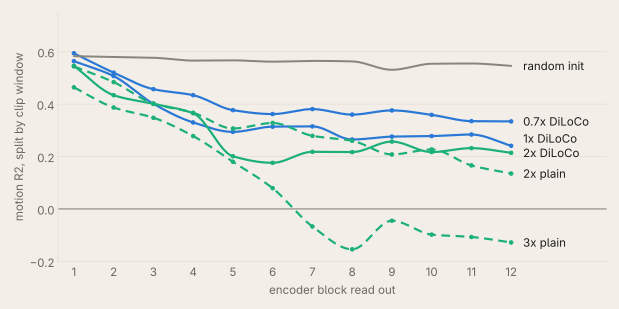
  </picture>
</p>

Motion information is highest at block 1 and decreases with depth, faster at a larger update. Last block: 0.33 at 0.7x, 0.24 at 1x, 0.21 and 0.14 at 2x, −0.13 at 3x. A random initialisation stays near 0.55. The 9-machine 1x encoder of section 4 (60 rounds, not drawn) holds up best: 0.65 at block 1 and 0.49 at block 12. One seed per setting, 48 windows.

Validation loss does not follow this ordering:

<p align="center">
  <picture>
    <source media="(prefers-color-scheme: dark)" srcset="assets/loss_vs_motion_dark.svg">
    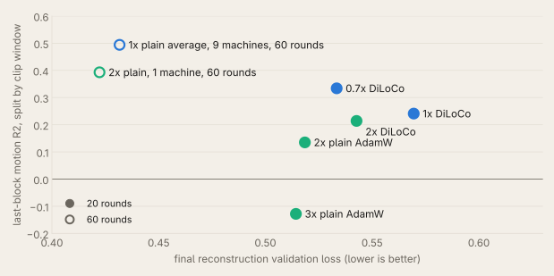
  </picture>
</p>

Among the five 20-round encoders, the lowest loss (3x, 0.514) goes with the lowest readout (−0.13). Five points: a description, not a test.

### C. A second collapse, and its fix

The small LeVJEPA encoder had its own failure. With its regulariser (SIGReg) computed on batches of 16, the effective rank of its final token falls to about 1.2 within one round, and a speaker-identity probe over 118 speakers falls below a random initialisation. Pooling the regulariser over a batch of 256 removes it.

<p align="center">
  <picture>
    <source media="(prefers-color-scheme: dark)" srcset="assets/collapse_fix_dark.svg">
    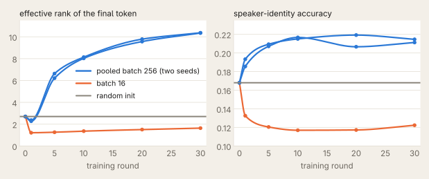
  </picture>
</p>

With the pooled batch, rank reaches 10.4 and speaker identity 0.21, on both seeds. With batch 16: rank 1.2 to 1.6, speaker identity 0.12. Random initialisation: rank 2.7, speaker identity 0.168. The rank fix alone did not improve valence and arousal: on the gate, these encoders scored about 0.03 below a random initialisation (measured before the seeding fix).

### D. The system in more detail

Synchronous multi-node training, measured before choosing DiLoCo:

<p align="center">
  <picture>
    <source media="(prefers-color-scheme: dark)" srcset="assets/throughput_scaling_dark.svg">
    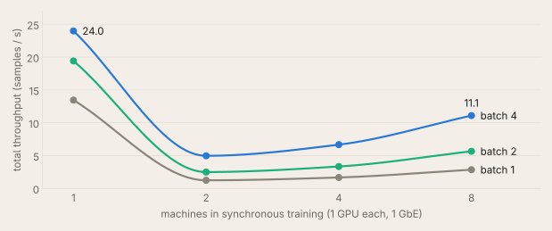
  </picture>
</p>

At batch 4, eight machines exchanging gradients every step process 11.1 samples/s; one machine alone processes 24.0. Exchanging only every eight steps (gradient accumulation) reaches 60.8 samples/s, 2.5 times one machine, at an effective batch of 256: the cost is the exchange, which DiLoCo cuts further. So each worker is one GPU process with no `torch.distributed`: it trains locally on the shards it holds and pushes a checkpoint once per round.

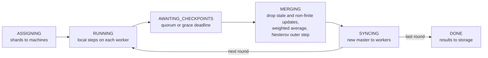

- **Watcher.** A one-minute tick advances every run's state machine and runs six detectors: dead job, stalled job, foreign GPU process, quota, drained node, NaN. A dead job is resubmitted once; a second death escalates. The quorum shrinks for missing machines, never below 60% of the pool.
- **Class-hours gate.** No job runs on weekdays from 08:00 to 20:00, and a job is refused if any part of its walltime would overlap that window. Enforced in the job scripts, in a shim in front of `sbatch`/`srun`/`salloc`, and in the watcher.
- **Tests.** About 1.9k tests mirror the package.
- **Gate seeding.** Until 2026-11-01 the gate did not apply its seed, so seeds within one job could repeat and intervals computed before that date are too narrow. Only results re-run after the fix are given with an interval.

### E. Tables

| Effective multiplier | Route | Last-block motion R² | Stream norm after block 12 |
|---|---|---|---|
| 0.7x | DiLoCo, 0.7 / 0.0 | 0.64 | 91 |
| 1x | plain AdamW (2 seeds) | 0.65, 0.66 | 92, 95 |
| 2x | DiLoCo, 0.2 / 0.9 | 0.62 | 193 |
| 2.25x | DiLoCo, 0.45 / 0.8 | 0.63 | 162 |
| 3x | plain AdamW, learning rate × 3 | 0.56 | 137 |
| 7x | DiLoCo, 0.7 / 0.9 (2 seeds) | 0.53, 0.54 | 373, 375 |
| 7x | plain AdamW, learning rate × 7 (2 seeds) | 0.41, 0.43 | 459, 406 |
| *random init* | | *0.64* | *45* |

| Arm (n = 30) | CCC | Valence | Arousal |
|---|---|---|---|
| Random init | 0.054 | 0.090 | 0.018 |
| Released ViT-L | 0.287 | 0.090 | 0.483 |
| **Released ViT-L + continued pretraining** | **0.331** | **0.176** | **0.487** |

---

Vianney Gauthier · [github.com/VianneyGG](https://github.com/VianneyGG) · All rights reserved.
